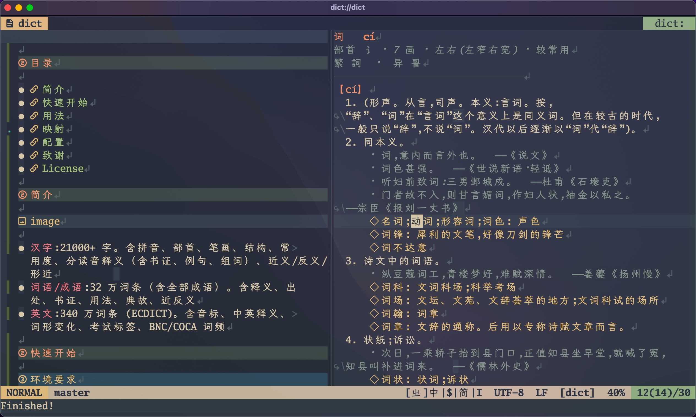

<p align="center">
  
</p>
<p align="center">A Chinese-English Dictionary Plugin for Vim / Neovim</p>
<p align="center">
  <a href="https://opensource.org/licenses/MIT"></a>
  <a href="https://www.vim.org"></a>
  <a href="https://neovim.io"></a>
</p>

## 目录

- [简介](#简介)
- [快速开始](#快速开始)
- [用法](#用法)
- [映射](#映射)
- [配置](#配置)
- [致谢](#致谢)
- [License](#license)

## 简介



- **汉字**:21000+ 字。含拼音、部首、笔画、结构、常用度、分读音释义（含书证、例句、组词）、近义/反义/形近
- **词语/成语**:32 万词条（含全部成语）。含释义、出处、书证、用法、典故、近反义
- **英文**:340 万词条 (ECDICT)。含音标、中英释义、词形变化、考试标签、BNC/COCA 词频

## 快速开始

### 环境要求

- Vim ≥ 8.2 或 Neovim ≥ 0.5
- sqlite3 CLI ≥ 3.33
- python3 ≥ 3.5

`sqlite3` 和 `python3` 需在 `PATH` 中。

### 安装

- **vim.pack**

```vim
vim.pack.add({
  "https://github.com/TSalmon3/dict.vim"
})
```

- **vim-plug**

```vim
Plug 'TSalmon3/dict.vim'
```

### 数据目录

> [!Warning]
> 数据不随插件发布，需从 [Releases](https://github.com/TSalmon3/dict.vim/releases) 下载 `dict-data-<version>.tar.gz`。

插件默认读取自身目录下的 `dict/` 目录：

```text
<插件目录>/dict/
```

数据目录结构如下：

```text
dict/
├── character/   中文单字
├── word/        中文词语
├── idiom/       成语
└── word_en/     ECDICT 英文数据
```

或者通过 `g:dict_data_dir` 指定数据目录

```vim
let g:dict_data_dir = '~/Downloads/dict.vim/dict'
```

### 初始化

```vim
:DictInit                " 读 g:dict_data_dir
:DictInit!               " 删库重建
:DictInit /path/to/dict  " 临时指定数据目录
```

## 用法

```
:Dict 反          " 单字 → 汉字卡片
:Dict 一帆风顺    " 词条 → 释义/出处/书证/用法/典故卡片
:Dict 一帆        " 未精确命中 → 中文前缀候选列表
:Dict hello       " 英文单词 → 音标/释义/词形/标签卡片
:Dict take off    " 英文短语 → 短语卡片
:Dict hell        " 未精确命中 → 英文前缀候选列表
```

## 映射

```vim
nnoremap ;c <Plug>(dict-lookup)   " normal: 查询光标下的汉字/词
xnoremap ;c <Plug>(dict-word)     " visual: 查询选中文本
```

## 配置

```vim
let g:dict_db_path      = '<插件目录>/dict.db'   " 数据库位置
let g:dict_data_dir     = '<插件目录>/dict'      " 数据源目录(character/ word/ idiom/ word_en/)
let g:dict_split_width  = 50                     " 窗口宽度,0 为默认一半
let g:dict_history_max  = 50                     " 查询历史上限(正整数)

let g:dict_keymaps = {
      \ 'lookup':  '<CR>',
      \ 'back':    '<C-o>',
      \ 'forward': '<C-i>',
      \ 'help':    '?',
      \ 'close':   'q',
      \ }

" 或者只覆盖特定项
" let g:dict_keymaps = {'back': '[', 'forward': ']'}
```

指定第三方取词接口：

```vim
let g:dict_cword_func = 'JiebaCword'
```

## 致谢

- [chinese-dictionary](https://github.com/mapull/chinese-dictionary) - 中文汉语拼音辞典，汉字拼音字典，词典，成语词典，常用字、多音字字典数据库
- [ECDICT](https://github.com/skywind3000/ECDICT) - Free English to Chinese Dictionary Database

## License

[MIT](./LICENSE)
